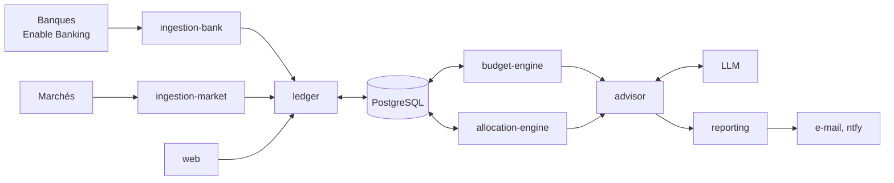

# Patrimoine

**Suivez tout votre patrimoine, chez vous.** Application auto-hébergée qui regroupe les comptes, placements et budget d'un foyer, avec des chiffres fiables et un conseiller IA qui cite ses sources.

> *English:* Patrimoine is a self-hosted wealth tracker. It aggregates a household's accounts through Enable Banking, handles budget, goals and allocation, and sends AI-generated advice by email. The LLM never makes up a number: figures come from deterministic services and every recommendation must cite verified facts. Work in progress, Apache-2.0.

[](https://github.com/ECG-Rudy-Glt/PATRIMOINE/actions/workflows/ci.yml)


**[Site](https://patrimoine-open.gault-rudy.com)** · **[Démo interactive](https://patrimoine-demo.gault-rudy.com)** (données fictives, visite guidée)

## Le but du projet

- **Tout visualiser** : comptes courants, épargne, assurance-vie, bourse, crypto et immobilier dans une seule vue.
- **Recevoir des conseils par e-mail** : un digest mensuel, à chaque paie, résume la situation et les recommandations de l'IA, pour chaque personne du foyer.
- **Centraliser les comptes de toute la famille**, avec une vue « foyer » et une vue par personne.
- **Rester maître de ses données** : tout s'installe chez vous, rien n'est revendu.

## Statut

Le projet est **ouvert et en construction**. Il est utilisé en production par son auteur, mais l'interface et les schémas peuvent encore évoluer. Les retours, idées et contributions sont les bienvenus (voir [CONTRIBUTING.md](CONTRIBUTING.md)).

## Fonctionnalités

| | |
|---|---|
| **Comptes** | Agrégation des banques par les API DSP2 officielles via [Enable Banking](https://enablebanking.com/) (lecture seule, accès restreint gratuit à ses propres comptes). |
| **Budget** | Catégorisation automatique par règles, budget par cycle de paie, montant épargnable. |
| **Objectifs** | Suivi de chaque objectif d'épargne (précaution, retraite, projet…). |
| **Placements** | Positions, prix de revient, allocation réelle contre cible, filtre fiscal, coût des frais. |
| **Fiscalité** | Éligibilité LEP, plafond PER, ancienneté assurance-vie et PEA, plafonds des livrets. |
| **Alertes** | Solde bas, dérive d'allocation, relevé à rafraîchir, via ntfy, notification web ou Home Assistant. |
| **Conseiller IA** | Faits chiffrés → recommandations validées. Chaque citation est vérifiée par le serveur. Aujourd'hui avec Claude (Anthropic) ; l'ouverture à d'autres modèles, en ligne ou locaux, est en cours. |
| **Rapports** | Digest mensuel par e-mail et classeur Excel. |
| **Foyer** | Plusieurs personnes, quote-part par compte, vue foyer et vues individuelles. |
| **Tableau de bord** | Interface React claire/sombre, plus un tableau Grafana « Patrimoine total ». |

Principe directeur : **le LLM n'invente aucun chiffre**. Les calculs sont faits par des services déterministes ; l'IA les interprète et les formule. Toute estimation est marquée « ≈ ».

## Démarrage rapide

Prérequis : Docker et Docker Compose.

```bash
git clone https://github.com/ECG-Rudy-Glt/PATRIMOINE.git
cd PATRIMOINE
./scripts/setup.sh                # crée .env avec des mots de passe aléatoires
docker compose up -d --build
```

Ouvrez <http://localhost:8080>. L'application démarre avec deux personnes d'exemple, *Alex* et *Sam* (à renommer), et des données de référence génériques.

Pour la configuration complète (banques, conseiller IA, e-mail, notifications), voir [docs/deploiement.md](docs/deploiement.md).

## Architecture



Détail des services, du schéma et des principes : [docs/architecture.md](docs/architecture.md).

## Documentation

- [Architecture](docs/architecture.md)
- [Déploiement](docs/deploiement.md) : installation, banques, planification, reverse proxy, sauvegardes
- [Workflow de développement](docs/workflow.md) : environnement, tests, migrations, CI
- [Sécurité](SECURITY.md)

## Tests

```bash
./scripts/test.sh
```

Tests unitaires des services, application des migrations sur une base jetable et appel des fonctions SQL clés. Le même script tourne dans la CI.

## Sécurité en bref

- Les identifiants bancaires ne sont **jamais stockés** : ils sont saisis chez la banque.
- Les secrets restent dans `.env` et `secrets/`, ignorés par git. Les ports sont liés à `127.0.0.1`.
- L'application n'a **pas d'authentification intégrée** : placez-la derrière un reverse proxy qui authentifie. Pas de chiffrement des données au repos fourni : chiffrez votre disque ou volume.

Détails et signalement d'une faille : [SECURITY.md](SECURITY.md).

## Avertissement

Patrimoine est un outil d'aide à la décision, pas un conseil en investissement. Les recommandations sont des propositions que vous validez vous-même ; rien n'est exécuté automatiquement.

## Licence

[Apache 2.0](LICENSE). Un projet de [Rudy Gault](https://portfolio.gault-rudy.com).
