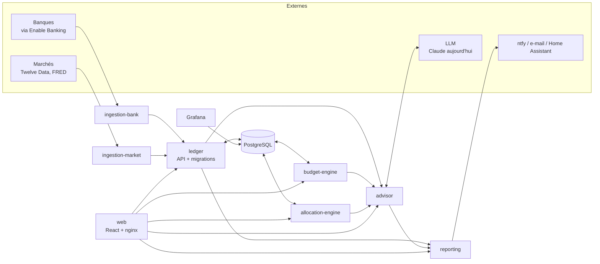

# Architecture

Patrimoine est un ensemble de petits services Python (FastAPI) autour d'une base PostgreSQL, avec une interface React. Tout tourne avec Docker Compose.

## Vue d'ensemble

## Les services

| Service | Rôle |
|---|---|
| `postgres` | Source de vérité : comptes, transactions, valorisations, positions, règles, réglages. |
| `ledger` | API d'écriture et de lecture du patrimoine. Applique les migrations SQL au démarrage. |
| `ingestion-bank` | Connecteurs bancaires (Enable Banking par défaut, Powens optionnel) qui alimentent le ledger. `bank-api` expose l'écran « Banques » (ajout, renouvellement, alerte d'expiration). |
| `ingestion-market` | Cours (Twelve Data) et données macro (FRED). Tâche planifiée. |
| `budget-engine` | Catégorisation par règles, budget par cycle de paie, montant épargnable, fiscalité (plafonds, ancienneté). |
| `allocation-engine` | Positions, prix de revient, allocation réelle contre cible, filtre fiscal. |
| `advisor` | Conseiller IA : reçoit des faits chiffrés identifiés par une clé, produit des recommandations en JSON dont les citations sont vérifiées par le serveur. |
| `reporting` | Digest mensuel par e-mail, récapitulatif hebdomadaire, rapport Excel. |
| `web` | Interface (React + Vite), servie par nginx, qui relaie les appels aux services. |
| `grafana` | Tableau de bord technique « Patrimoine total ». |

## Principes

- **Le LLM n'invente aucun chiffre.** Les calculs financiers sont faits par les services déterministes (`budget-engine`, `allocation-engine`, `ledger`). Le conseiller reçoit ces faits, les interprète et les formule. Chaque recommandation doit citer les clés des faits sur lesquels elle s'appuie, et le serveur rejette les citations inventées et affiche lui-même les valeurs.
- **Les estimations sont signalées** (« ≈ ») : une valeur approximative n'est jamais présentée comme exacte.
- **Les recommandations sont des propositions.** Rien n'est exécuté automatiquement.
- **Les identifiants bancaires ne sont jamais stockés.** Ils sont saisis chez la banque ; le projet ne conserve que la session d'accès en lecture seule (`secrets/sessions.json`).
- **Plusieurs personnes dans un foyer** : chaque compte a ses titulaires et une quote-part. L'interface propose la vue « foyer » et la vue de chaque personne.

## Base de données et migrations

Le dossier `db/migrations/` contient les fichiers SQL appliqués dans l'ordre :

- `001_schema.sql` : structure complète (tables, vues, fonctions).
- `002_seed.sql` : données de référence génériques (catégories, barèmes fiscaux, réglages par défaut) et deux personnes d'exemple, *Alex* et *Sam*, à renommer.

À la première création du volume PostgreSQL, Docker applique ces fichiers. Le `ledger` tient ensuite à jour une table `schema_migrations` et applique au démarrage toute nouvelle migration (`003_*.sql`, …). Sur une base existante non suivie, il marque simplement les fichiers comme déjà appliqués.

## Authentification

L'application n'embarque pas de système de comptes : elle est conçue pour être placée derrière un reverse proxy qui authentifie (par exemple un SSO comme Authentik ou Authelia). Les ports du `docker-compose.yml` sont donc liés à `127.0.0.1`. Voir [deploiement.md](deploiement.md).

## Limites actuelles

- Le conseiller utilise l'API Claude (Anthropic) ; l'ouverture à d'autres modèles de langage, en ligne ou locaux, est en cours.
- Le foyer est pensé pour deux personnes ; la généralisation est prévue.
- Pas de chiffrement des données au repos fourni par l'application : utilisez le chiffrement du disque ou du volume de votre hébergement.
- Le projet est en construction : l'interface et les schémas peuvent évoluer.
